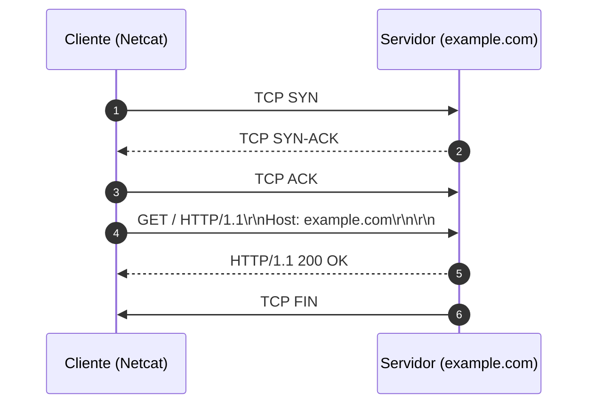

---
---
# lab-guilhermefreire
Repositório para registro das atividades práticas na aula de desenvolvimento web
# Memória de Desenvolvimento — Semana 01
**Aluno:** Guilherme Freire Dias 
**Matrícula:** 202511250028
**Curso:** Engenharia da Computação  

---

## 1. Mapeamento da Camada de Transporte
Diagrama Mermaid demonstrando o ciclo de vida da requisição executada no laboratório:

---

## 2. Captura Bruta e Análise do Protocolo
* **Comando Utilizado:** `nc -C example.com 80`
* **Status Line Retornada:** `HTTP/1.1 200 OK`

### Análise dos Headers Recebidos:
1. **`Content-Type`:** Atua mostrando ao cliente o tipo de arquivo retornado. Com isso, sendo importante para que o navegador ou programa saiba como ler os dados recebidos, renderizalos no HTML e codificalos em utf-8.
2. **`Content-Length`:** Informa qual o tamanho do conteúdo em bytes. Com esse valor, ele sabe exatamente quando o payload acabou, consegue detectar respostas truncadas e, em conexões persistentes, sabe onde começa a próxima resposta.
3. **`Connection: close`:** O connection close india que o servidor encerrará a conexão TCP após enviar a resposta. Dessa forma criando um novo handshake para cada requisição, o que dificulta a latência e custo. Já o Keep-alive permite manter a conexão aberta o tempo todo para ser utilizada novamente em outras requisições.

---

## 3. Conclusão Técnica
Entendi que o HTTP é o protocolo da camada de aplicação que define o formato da comunicação entre cliente e servidor, e que ele funciona sobre uma conexão TCP. Os dados trafegam como uma sequência contínua de bytes, seguindo a estrutura do protocolo. Os cabeçalhos HTTP são separados por CRLF (\r\n), e uma linha em branco (\r\n\r\n) marca o fim dos cabeçalhos e o início do corpo da mensagem. Isso é essencial porque o TCP não delimita mensagens, e é essa marcação que permite ao cliente saber onde terminam os metadados e começa o conteúdo.
